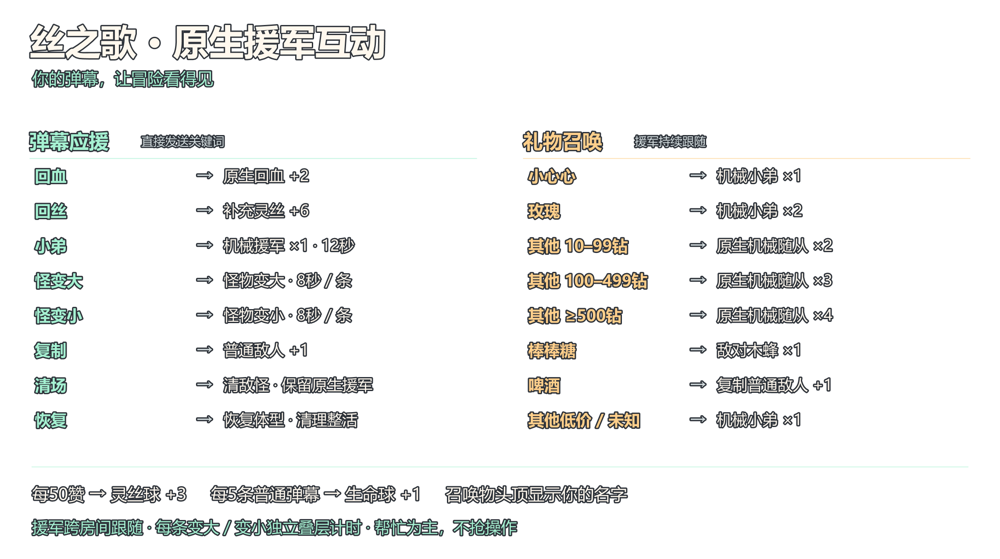

# LiveInteract · 直播互动工具箱

**让观众的弹幕、点赞和礼物，变成《丝之歌》里的助力与整活。**

Windows 中文桌面工具，首版接入抖音直播与 Steam《Hollow Knight: Silksong》。一个互动对应一个效果：选择具体怪物、填写召唤数量，或配置回血、回丝、原生随从和体型整活，不用编写动作链。

[下载 Windows 便携包](https://github.com/3196024836/LiveInteract/releases/tag/v0.4.0) · [快速开始](docs/快速开始.md) · [默认互动配置](profiles/使用说明.md) · [版本记录](CHANGELOG.md)

> **0.4.0 为预发布版本。** 最终原生效果调整已编译打包，但未完成新一轮游戏回归和真实付费直播验收。正式用于有付费互动的直播前，请先自行核对接收记录与游戏回执；当前不提供“100%读取 / 100%生效”的保证。

## 可以做什么

### 一条互动，一个可配置效果

- 支持弹幕关键词、礼物名称 / ID、礼物单价区间、累计点赞、关注等触发条件。
- 具体怪物、每次数量、回复量、持续时间和叠加方式可编辑。
- 功能库提供具名怪物、Boss、六种原生丝技，以及其他游戏效果。Boss 属试验功能，可能依赖原场景；默认配置不绑定 Boss 或永久改档。
- 默认规则以帮助主播为主，不默认强制施放大招，不接管走位。

### 原生随从助战，少量看得见的整活

- 召唤游戏原生机械飞行随从，使用其原生外观和战斗 AI，显示召唤者昵称并跨房间跟随。
- 礼物分档通过召唤数量区分，不把换皮怪物包装成原生新友军。
- 怪物外观变大 / 变小：每条触发独立计时和叠层，不靠刷新同一条倒计时覆盖前一次；不放大碰撞体。
- 复制最近普通敌人，排除 Boss；清理敌对召唤时保留随从。
- 回血、回丝使用游戏已有入口；不生成自制补给球或自绘游戏道具。

### 收到、等待、失败，都有记录

- 接收账本、原始帧与执行队列持久化，保留礼物连送增量、点赞累计余数和未完成任务。
- 过场、死亡、目标暂缺或达到生成上限时等待，不把等待当成功。
- 支持按来源、状态、昵称、效果和错误原因筛选；内置控制台显示失败诊断。
- 断连后的未知结果先查游戏端回执，不盲目重发；重启后由主播明确恢复积压队列。
- 游戏内使用简洁渐隐通知与召唤者昵称，也提供独立 OBS 透明展示及两套透明说明 PNG。

### 本地工具，便携运行

- Windows x64 自包含包，携带 .NET 与固定版 WebView2，无需另装开发环境。
- 内置 Mod 安装、修复、停用、卸载与存档备份；受保护目录通过短时维护辅助进程申请权限。
- 旧规则先备份再导入；互动总开关由主播手动开启。暂停与紧急恢复分开处理。
- 当前发布的游戏适配器只有丝之歌；代码按协议、规则、桌面与游戏适配分层，后续可扩展其他游戏。

## 默认怎么玩

| 观众互动 | 默认效果 |
| --- | --- |
| 弹幕 `回血` | 回血 2 格 |
| 弹幕 `回丝` | 补充灵丝 6 点 |
| 弹幕 `小弟` | 原生机械随从 1 只，持续 12 秒 |
| 弹幕 `怪变大` / `怪变小` | 每条独立叠层，持续 8 秒 |
| 弹幕 `复制` | 最近普通敌人 +1，不复制 Boss |
| 弹幕 `清场` / `恢复` | 清理敌对召唤 / 恢复体型整活，保留随从 |
| 小心心 / 玫瑰 | 原生机械随从 1 / 2 只，持续跟随 |
| 棒棒糖 / 啤酒 | 敌对木蜂 +1 / 复制普通敌人 +1 |
| 每累计 50 赞 | 补充灵丝 3 点，余数继续累计 |
| 每 5 条未命中口令的普通弹幕 | 回血 1 格 |

其他礼物按平台提供的单价分档召唤 1–4 只原生机械随从；单价未知时使用基础档。钻数来自平台字段，不根据礼物名称推测价格。完整规则和别名以 [默认 JSON](profiles/丝之歌-弹幕助力.json) 为准，配置可以随时从文件读取或修改。

默认同时生成上限为 0（不限制），每份触发独立保留。大量实体仍会增加游戏负载；需要限流时请显式设置上限，超限任务留队等待。

### 透明直播说明图

下图是规则说明，不是游戏效果截图；只有文字、透明背景，不含自绘角色或换皮素材。OBS 可直接添加“图片”源。



[横版 PNG](直播素材/丝之歌-友军整活/直播互动说明-横版透明.png) · [竖版 PNG](直播素材/丝之歌-友军整活/直播互动说明-竖版透明.png)

## 三步开始

1. 从 [v0.4.0 发布页](https://github.com/3196024836/LiveInteract/releases/tag/v0.4.0) 下载 ZIP，完整解压后运行 `直播互动工具箱.exe`。不要只从压缩包内拖出 EXE。
2. 在“Mod 与存档”安装 / 修复插件，正常通过 Steam 启动游戏。在内置抖音页面由本人登录并进入自己的直播间。
3. 在“触发规则”选择“读取默认助力配置”，打开 `profiles/丝之歌-弹幕助力.json`。先确认游戏连接和规则，再手动开启互动。

详细步骤、升级与故障处理见 [快速开始](docs/快速开始.md)。

## 兼容与已知限制

- 首版目标：Windows x64、Steam 丝之歌；本机适配记录为游戏 1.0.30000 / Build 22479045，不代表所有后续版本已验证。
- 抖音页面、协议、登录验证及平台下发行为可能变化。平台未发送、断网或账号风控造成的缺失，不能靠本地队列补造。
- 回执成功、资源实际增加、怪物完整 AI 和真实付费直播一致性是不同的验收项。满值可能显示“无变化”；未知状态必须人工核对。
- 已有游戏背景日志、跨场景 Boss、长时间直播以及另一台干净电脑仍有待验收项。详情见 [兼容与验收](docs/兼容与验收.md)。
- 用户登录态、Cookie、存档、原始直播帧、队列数据库和本机测试资料不随源码或发行包公开。

## 本地开发

需要 .NET SDK **10.0.401**、Windows，以及自己合法安装的 Steam 丝之歌。游戏程序集仅作本机编译引用，不随仓库分发。

```powershell
# 构建并运行测试（开发者按需执行）
.\scripts\build.ps1

# 完整便携包：默认构建与测试，并强制使用非 QA Mod 编译
.\scripts\package.ps1

# 重新生成纯文字透明说明图
dotnet run --project tools/PosterRender/PosterRender.csproj -c Release -- "$PWD"
```

游戏不在默认位置时，可直接传入编译属性：

```powershell
dotnet build LiveInteract.sln -c Release -p:GameManagedPath="D:\SteamLibrary\steamapps\common\Hollow Knight Silksong\Hollow Knight Silksong_Data\Managed"
```

打包脚本保留现有发行目录，不覆盖已经生成的包。正式包强制 `QaBuild=false`，不包含 QA 控制入口。下载依赖的来源与第三方条款见 [第三方说明](docs/THIRD_PARTY_NOTICES.md)。

### 工程结构

| 目录 | 用途 |
| --- | --- |
| `src/LiveInteract.Contracts` | 事件、动作目录、IPC 数据与参数校验 |
| `src/LiveInteract.Core` | 协议解码、规则、持久队列、安装与备份 |
| `src/LiveInteract.Desktop` | WPF 中文桌面界面与 WebView2 |
| `src/LiveInteract.Silksong` | BepInEx 适配器、游戏线程执行与回执 |
| `profiles` | 可导入的默认 JSON 与说明 |
| `tests`、`tools` | 回归测试、开发辅助与说明图排版 |

## 反馈问题

请在 Issues 提供工具 / 游戏版本、触发方式、预期与实际结果，以及已去除隐私的错误原文。**不要提交 Cookie、账号登录数据、完整直播原始帧或个人存档。**

## 权利与许可

本仓库公开源码，当前没有为项目原创代码设置统一开源许可证；不要将“可查看源码”视为获得任意再分发或商业使用授权。第三方组件分别遵循各自许可。游戏名称、角色与原生资源的权利属于其各自权利人，本项目不附带游戏本体资源，也不代表 Team Cherry 或抖音官方。
